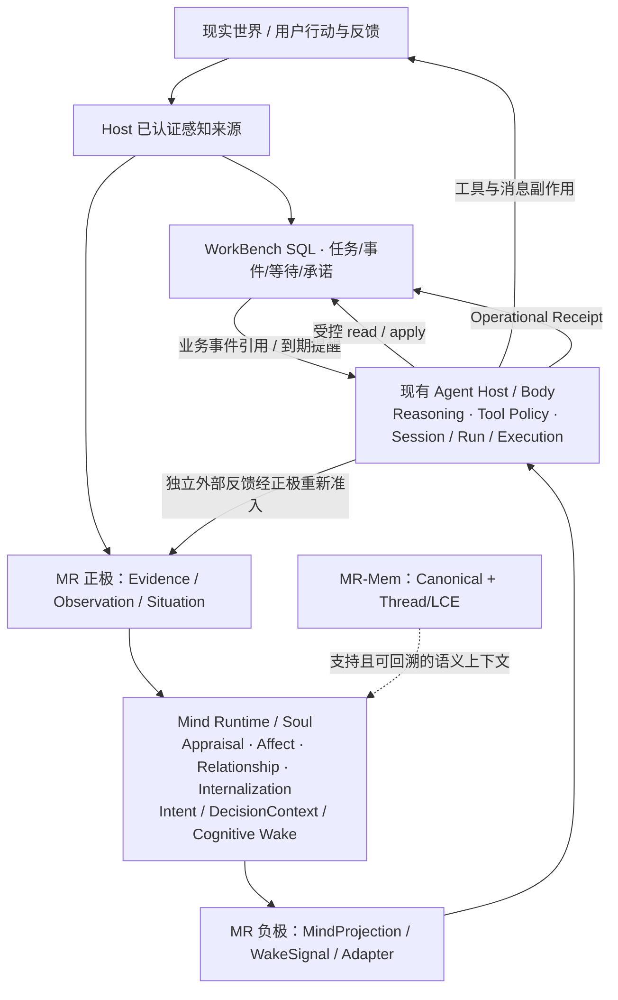

# Mind Runtime × WorkBench：设计思路、认知唤醒与执行边界

> **状态：跨项目集成设计补充（Proposed），不修改已冻结的 MR_ARCHITECTURE_LOCK v1.1。**
>
> 当前代码与测试 > 已接受 ADR / v1.1 架构冻结 > 本文件 > 早期讨论。若内容冲突，以更高权威为准，先走 ADR 变更与测试，不暗中扩充 MR 的职责。

## 1. 这次为什么必须强调 MR 与 Agent Host 的区别

Anthropic 2026-11-13 *Building always-on agents* 提供了一个有价值的工程图景：Agent 不必不断推理，可在事件到来时醒来，一次性工作、持久化状态，必要时等待审批并恢复执行。

但它是 **Agent Host / 产品的运行模式**，不能被理解为“MR 应该承包事件队列、真实工具执行、Telegram 和工作流”。

MR 已冻结的产品本体并不是一般 Planner/Agent OS，而是**以认知记忆为核心的情感 Harness / Soul**：现实经历经 Situation、Appraisal、Affect、Relationship、Internalization，改变后续意图、决策倾向与表达，并允许跨不同 Body 延续这种影响。

因此必须把四种连续性分开：

| 连续性 | 正确系统 | 失效时由谁恢复 |
|---|---|---|
| 真实任务/承诺/等待/催促 | Agent-WorkBench | WorkBench SQL + timer/outbox |
| 正在执行的 Run/Session/工具调用 | Agent Host（现有 Body） | Host checkpoint/session 机制 |
| 认知/情感/关系/内化/主动意图 | Mind Runtime | MR 现有持久状态和受控 runtime binding |
| 语义记忆、历史支持与 Thread/LCE | MR-Mem / MR 的记忆集成 | Canonical/来源回溯/投影恢复 |

这里不能偷换概念：**Mind WakeSignal ≠ WorkBench WakeEvent ≠ Host Run**。

## 2. 从已有 Soul/Body 冻结推导出的系统拓扑



这只是跨项目**逻辑拓扑**，不表示上述所有接口目前已经接通。Host 仍持有 final permission、recipient addressing、tool invocation、credentials、carrier 与 external side effects。

## 3. 两种主动性：为什么不应合并

### A. MR 的认知主动性

已有 v1.1 定义了：elapsed time + internal affect/relationship/situation dynamics → proactive desire / intent → cognitive policy → **WakeSignal**。它表达的是“当前内在世界倾向于唤醒 Body 关注某件事”。

这种意图依赖情境、内化、关系与认知状态，不能用 WorkBench 的简单时间戳取代。MR 不直接选外部平台、动作工具或收件人；Body 仍有权拒绝此意图并记录原因。

### B. WorkBench 的业务触发

例如“周三提醒我追问那份文件”是**明确的人类任务约束**。时钟到了，WorkBench 原子产生一个业务 WakeEvent，进入 Host 的事件队列即可；这不需要经过情绪评价，也不应该由于 MR 情绪状态变化被偷偷删除或延迟。

关系：业务 Trigger 和认知 WakeSignal 都可以成为 Body **候选输入**，但前者不是“MR 的思想”，后者不是“已经获准的任务指令”。最终何时启动 Run、运行哪段工具流、是否允许副作用，由 Host 的执行/权限策略决定。

## 4. 状态权威和操作/经验反馈双平面

MR 冻结的 Operational vs Experiential 分离在这个工作台中尤为重要：

**Operational Feedback**：消息发送完成、HTTP 200、Run 已结束、工具调用返回、Outbox receipt、任务标签更改。它们只证明系统进行了什么操作；可用于交接、重试、幂等和操作审计。

**Experiential Feedback**：用户或环境实际做出回应，并作为合法外部 Evidence 经感知边界准入，再进入 Situation→Appraisal→Affect/Relationship/Memory/内化链。

禁止将下面的等号写进实现：

```text
Host Run completed ≠ WorkBench Task DONE
Telegram message sent ≠ user has read / liked / agreed
MR WakeSignal emitted ≠ Host tool permission granted
WorkBench approval approved ≠ tool security policy bypassed
Retrieved semantic Memory ≠ new Evidence or fresh user commitment
```

真实场景：Agent 为用户完成初稿并发送给高老师。Workbench 可写“初稿已发送，等待反馈”；MR 可在未来感知到用户对反馈的真实评价。但是 `sendMessage` 返回成功**不自动说明**高老师满意，更不应凭操作回执强化 MR 的关系权重。

## 5. 主路径：自然交互 / 延迟审批 / 中断恢复

### 自然交互

1. Telegram/其他 Host 接收到外部输入，先进行身份/来源/版本核查；
2. WorkBench 基于其业务事件/SQL 当前状态建立当前 task 上下文；
3. MR 正极若有被允许的外部 Evidence，按既有 admission 更新认知状态，不因 WorkBench 任务操作日志提升情感权威；
4. Host 可以向 MR 请求受限的 DecisionContext/WakeSignal，也可以在授权下从 MR-Mem 召回历史；
5. Host 决定行动，使用 WorkBench API 做合法业务修改或使用工具；
6. Host 结果以 operational receipt 进入对应记录。只有新的现实反应可作为新的 experiential evidence 再经过 MR 感知。

### 延迟审批

1. Host 工具调用受其自身 Tool Policy 限制，保存 deferred call 与 Session；
2. WorkBench 记录需要哪位用户批准、需要回复什么、何时截止；
3. WorkBench收到受信用户审批，产生 `approval_decided` 业务事件；
4. Host 重新验证审批范围、工具权限、当前参数与 session 版本后自行恢复；
5. MR **不储存 deferred tool call，也不拥有 Tool Permission**；如有真实人类反馈，仍必须从感知边界重新准入。

### 重启与恢复

- WorkBench 定时器/业务事件在 Host 死机期间继续存在；Host 恢复后从待办事件读取，不得将运行中断当成任务完成。
- Host 自行恢复 Session/工具执行 checkpoint；不从 MR-Mem Thread 内容推断工具是否已经执行。
- MR 自己的 internal intent/state/checkpoint 由 MR runtime 恢复；它的 WakeSignal 可能被 Host 接受或拒绝，但不重放真实世界副作用。
- MR-Mem 编译滞后不影响 WorkBench 的任务版本与官方期限；只能影响语义上下文的新鲜度。
- 如果一次真实外发结果处于 unknown，WorkBench/Host 核对 receipt；不能靠 MR 的主观“我似乎发过了”直接重试。

## 6. MR 的模块映射：哪些属于 MR，哪些绝不能移入

| MR 现有职责 | 与 WorkBench 的协作方式 | 不应新增的职责 |
|---|---|---|
| `runtime_binding.py` 与 Registry | 身份/存储作用域必须受信，不能由 WorkBench 文本注入 | 代替 Workspace 用户 ACL |
| `state/` 与 StateBar | 只保存 MR 规定的当前认知/感知状态 | 保存业务 NOW/NEXT 或任务进度作为第二权威 |
| `intents/` 与 CognitiveTicker | 输出认知意图、建议关注事项 | 执行 WorkBench 的官方 due scheduler |
| `delivery/` 与 C7 handoff | 记录 Soul→Body 交接/操作回执的因果链 | 直接建 Telegram Bot 或任意外发 Worker |
| `pipeline/` / `integrations/` | Body 认可的认知上下文接口与只读投影 | 代管 Host Session/Run、Tool Checkpoint |
| `memory/` / external MR-Mem | 可以召回可信语义上下文 | 将 Working Task SQL 归入 Canonical Memory |
| Observation Window | 只读观测 MR 状态和因果迹象 | 兼任 WorkBench 可写面板 |

如果后续开发需要修改上述冻结，先补新的 ADR 与可执行反例测试；不得因为工作台比较方便就把通用业务能力塞进 MR。

## 7. 为什么不采用的替代路线

- **MR 兼任 WorkBench 的 Scheduler/Agent Loop：** 会直接违反产品本体与 Soul/Body 权威分离；让 MR 的研究可验证性受到业务噪音污染。
- **以 LCE 的 Line 作为 Task 的执行日志：** Line 是衍生认知结构，不是原始业务权威；它不负责事务、日期、审批或外部副作用。
- **由 WorkBench 直接按计时器更新 MR 的 affect/state：** 时间事件不是自动的体验证据；MR 的内部动力学必须遵守自身规则。
- **让 Run 完成自动触发 MR reinforcement：** 操作反馈不能成为体验反馈。
- **把新的 Host 实现塞进本仓：** 已有 Host 应通过外部适配集成，MR 不是通用 Agent OS。

## 8. 施工与审查规则

本 PR 是文档边界变更，**未修改 MR 运行时代码**。其跨仓后续工作需要：

1. 让 WorkBench 与现有 Host 建立受信的 `wake_event -> Run` 协议；不碰 MR 代码；
2. 从 WorkBench SQL 只读事实与来源，按受信 Host adapter 提供给 Body；Body 决定是否调用 MR；
3. MR 在不增加执行权限的条件下输出认知建议/唤醒语义，且可以被 Body 拒绝；
4. MR-Mem 从来源事件过滤合格语义，保留审计引用；不存在从 Outbox receipt 直接增强认知的旁路；
5. 用反事实与故障注入证明：相同业务事件的可执行性不取决于 MR 情绪波动；同一 MR WakeSignal 不越权执行工具；Host 重启不丢 WorkBench 任务；真实用户反应与操作回执不会混用。

### 当前状态与未完成部分

已确认的是 MR 现有冻结边界，以及 WorkBench/MR-Mem 的设计契约。**没有证据表明**本次已经接通 Host→MR 的生产级 WakeSignal/SSE、Host Run 或 Telegram，也不能把这些文档的存在视为 E5/E6/R5/R6 工程或研究目标已经完成。

相关文件：
- [原跨仓交接说明](WORKBENCH_ALWAYS_ON_HANDOFF.md)
- [冻结的 MR_ARCHITECTURE_LOCK v1.1](../architecture/MR_ARCHITECTURE_LOCK_v1_1.md)
- [WorkBench 项目总蓝图](https://github.com/Jasonatafricanow/Agent-WorkBench/blob/feat/modular-backend-20261116/docs/PROJECT_BLUEPRINT.md)
- [MR-Mem 的接入设计逻辑](https://github.com/Jasonatafricanow/MR-Mem/blob/feat/workbench-user-context-20261116/docs/WORKBENCH_DESIGN_RATIONALE.md)

**架构结论：** WorkBench 让现实工作保持连续；Host 让具体执行能够继续；MR 让内在认知和经历造成的变化跨时间连续；MR-Mem 让这些经历的语义支持和历史结构可回溯。只有如此，Always-on 才不会演变成另一套相互抢权威的 Agent OS。
